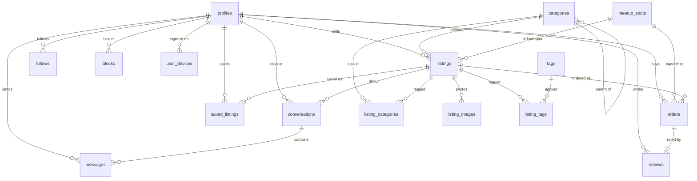

# Schema

The shape of the database, generated from what is actually deployed. Column
detail lives in `src/types/database.ts`; this is the picture and the access
rules, which no generated type carries.

Verified against the live project on **2026-10-22**: every relation the `anon`
role can reach was compared column-by-column between the deployed PostgREST
schema and `src/types/database.ts` — 13 relations, zero mismatches.

**16 tables · 3 views · 8 enums · 12 callable functions · 28 foreign keys**

A seventeenth table, `private.reports`, is outside the exposed schema — written
only through `submit_report()` and readable by nobody — so it is absent below.

## Entity relationships



## Read through the views

| View | Cols | Why it exists |
| --- | --- | --- |
| `listing_summaries` | 23 | The feed in one query — embeds `seller`, `meetup_spot`, `primary_image`, `image_count`, `is_saved`. `security_invoker = on`, which is what keeps the listings policy in force and resolves `is_saved` per viewer. |
| `my_profile` | 21 | Filtered to `auth.uid()` by the view, so no `.eq("id", …)`. |
| `public_profiles` | 15 | Resolves `show_last_active` on the way out. `last_active_at` is null for "never active" and "hidden" alike — do not try to tell them apart. |

**Never `select *` from `profiles`.** One row carries public trust signals,
owner-only preferences and server-written counters, so the split is done with
column grants rather than RLS. The statement is refused outright.

## Rules the diagram cannot show

- **The feed filters `status` itself.** The listings SELECT policy admits
  `active`, `reserved`, `sold` *and* `expired` — a buyer holding a link to a sold
  item should still see it. A feed that inherits that policy shows sold stock.
- **Sort on `bumped_at`, never `created_at`.** Renewing lifts a listing without
  backdating it, and `listings_feed_idx (campus, status, bumped_at desc)` is
  built for that triple. Dropping a filter costs the index.
- **Orders are written only by RPC.** Six functions own the lifecycle; each has
  to move the listing's status in the same transaction.
- **Views report every column nullable.** Postgres carries no `NOT NULL`
  information for views, so the generator is pessimistic. Narrow with
  `viewRow` / `viewRows` in `src/lib/queries/rows.ts`.
- **A write blocked by RLS reports no error.** An UPDATE filtered out by a USING
  clause matches zero rows and succeeds — the row count is the only evidence.
  That is what `requireWrite` checks.
- **Images need no signed URL.** `listing-images` and `avatars` are public
  buckets on purpose, so `getPublicUrl` is a local string build and a feed of
  cards costs no extra round trips. Writes stay owner-only.
- **Money is integer cents; time is an ISO string.** `0` means free, not
  unpriced. Timestamps are parsed at render, never stored as `Date`.

## Functions

Twelve of eighteen are reachable from a client. Grants were read from the
migrations, not inferred — two are granted in one migration and revoked in a
later one, and the net result is what counts.

| Function | Callable by | Does |
| --- | --- | --- |
| `is_username_available(text)` | anon + authenticated | Signup courtesy check; the insert re-validates. |
| `request_order(uuid, payment_method)` | authenticated | Buyer asks for an item. |
| `accept_order(uuid, uuid, timestamptz)` | authenticated | Seller accepts, names spot and time, reserves the listing. |
| `decline_order(uuid)` | authenticated | Seller refuses; listing returns to `active`. |
| `confirm_meetup(uuid)` | authenticated | Either side confirms the arrangement. |
| `confirm_handoff(uuid)` | authenticated | Second call completes the order and marks the listing sold. |
| `cancel_order(uuid)` | authenticated | Either side backs out before handoff. |
| `renew_listing(uuid)` | authenticated | Moves `bumped_at` and `expires_at` forward. |
| `mark_conversation_read(uuid)` | authenticated | Stamps `read_at` on the other party's messages. |
| `submit_report(reason, text, uuid, uuid, uuid)` | authenticated | Writes into `private.reports`. |
| `register_device(text, text)` | authenticated | Upserts the Expo push token. |
| `delete_my_account()` | authenticated | Anonymises into a tombstone. |
| `is_account_active(uuid)` | authenticated | RLS helper; policies are the real caller. |
| `is_blocked_between(uuid, uuid)` | **revoked** | Granted in the RLS migration, revoked in `20261004090000`. |
| `generate_username()` | **revoked** | Signup trigger. A VIU address is a real name, so usernames are generated. |
| `before_user_created_viu_gate(jsonb)` | auth hook | The server-side `@my.viu.ca` gate, called by GoTrue. |
| `expire_stale_listings()` | scheduled | The 30-day sweep. |
| `expire_stale_orders(interval)` | scheduled | Clears orders nobody acted on. |

## Enums

| Enum | Values |
| --- | --- |
| `campus` | `nanaimo` `cowichan` `powell_river` `parksville_qualicum` |
| `listing_status` | `draft` `active` `reserved` `sold` `removed` `expired` |
| `listing_condition` | `new` `like_new` `good` `fair` `poor` |
| `order_status` | `requested` `accepted` `completed` `declined` `cancelled` `expired` |
| `payment_method` | `cash` `etransfer` |
| `account_status` | `active` `suspended` `banned` `deleted` |
| `report_reason` | `prohibited_item` `academic_dishonesty` `scam_or_fraud` `counterfeit` `harassment` `spam` `other` |
| `report_status` | `open` `reviewing` `actioned` `dismissed` |

## Keeping this true

Regenerate types after every migration and diff them:

```sh
# from rabbithole/, never the repo root — the folder name becomes the Docker
# project id, and the root spawns a rival stack
npx supabase gen types typescript --linked > src/types/database.ts
```

The Mermaid block above is hand-maintained against those types. If a migration
adds a table or a foreign key, update it in the same change — a diagram that
drifts is worse than no diagram, because it is believed.
